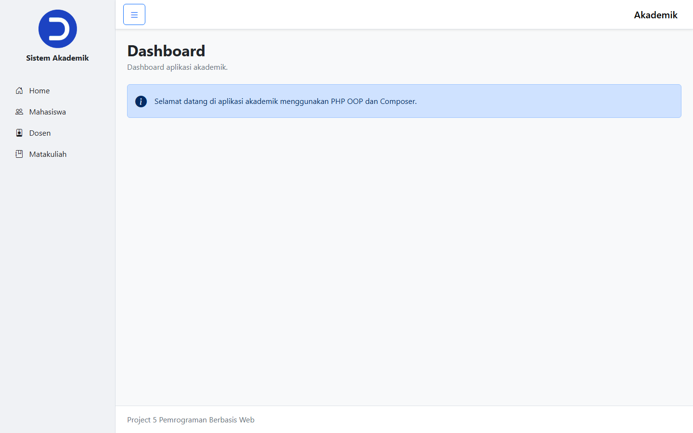
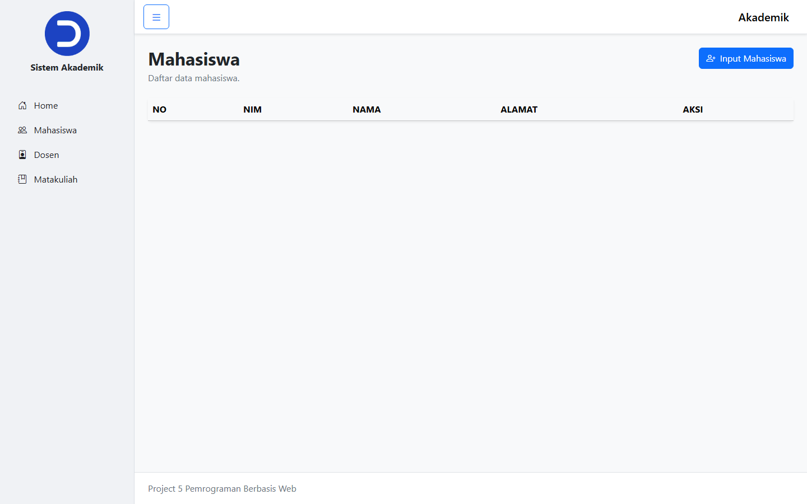
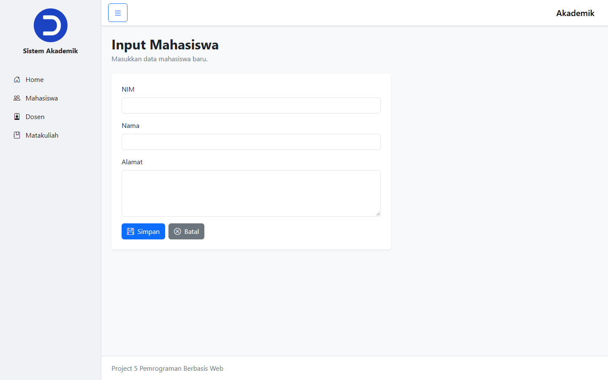
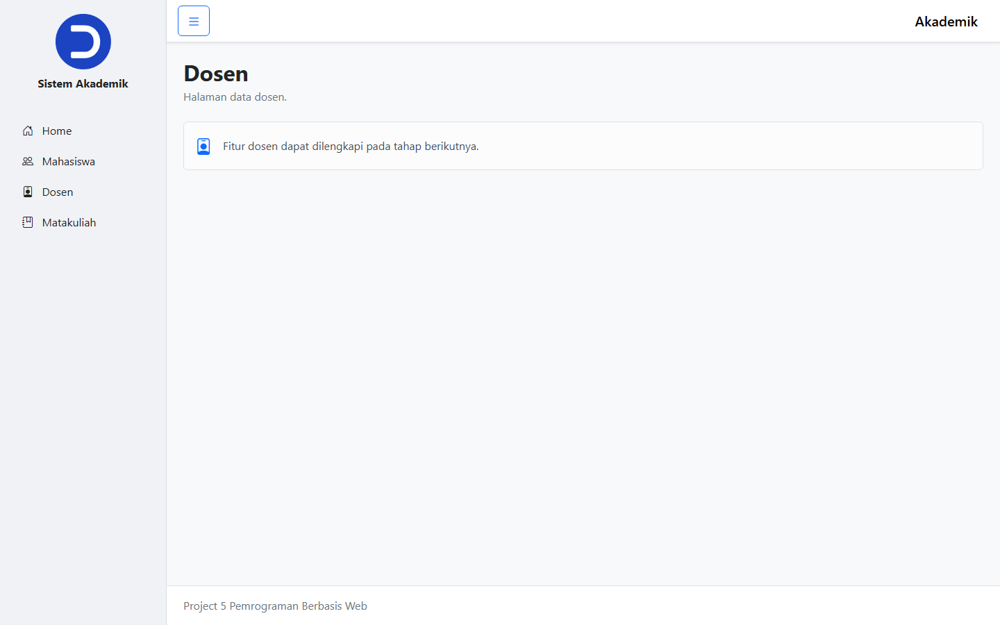
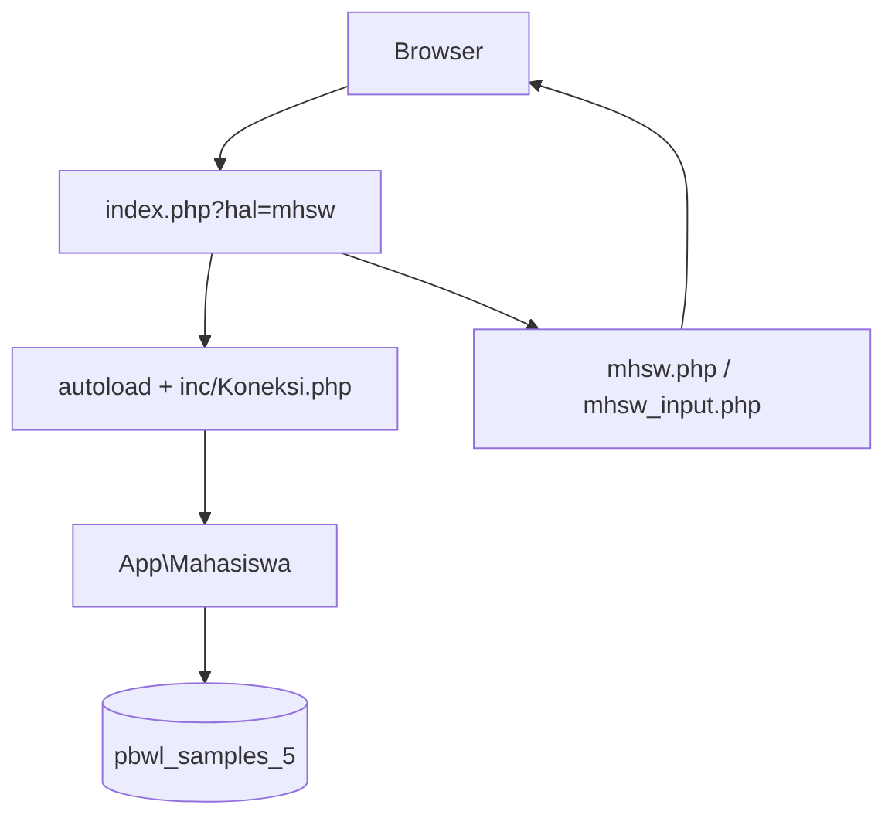

<div align="center">

# 🚀 Sistem Akademik — Project 5

**Project 5 · PHP OOP + Composer (versi lengkap)**

Versi lanjutan Sistem Akademik OOP dengan autoload Composer, halaman terpisah per entitas, dan alur proses yang lengkap.

     

</div>

---

## 📖 Deskripsi

Halaman disusun sebagai file mandiri (`mhsw.php`, `mhsw_input.php`, `mhsw_edit.php`, `mhsw_proses.php`) lalu disertakan lewat `index.php?hal=...`. Model `App\Mahasiswa` berbicara ke database melalui `inc/Koneksi.php`.

## 📸 Tampilan

<table>
  <tr>
    <td width="50%"><br><sub>Dashboard</sub></td>
    <td width="50%"><br><sub>Daftar Mahasiswa</sub></td>
  </tr>
  <tr>
    <td width="50%"><br><sub>Form Input</sub></td>
    <td width="50%"><br><sub>Daftar Dosen</sub></td>
  </tr>
</table>

## ✨ Fitur

- 🧩 Autoload PSR-4 (`App\` → `app/`)
- 📋 Daftar mahasiswa
- ➕ Input, ✏️ edit, 🗑️ hapus mahasiswa
- 🔄 Alur proses terpisah di `mhsw_proses.php`
- 👨‍🏫 Dosen & 📚 Matakuliah
- 🎨 Layout di `layouts/`

## 🧱 Teknologi

| Lapisan | Teknologi |
| --- | --- |
| Bahasa | PHP 8.0+ OOP |
| Autoload | Composer PSR-4 |
| Database | MySQL (PDO) |
| Routing | `?hal=` |
| Tampilan | HTML + CSS lokal |

## 🏗️ Arsitektur



## 🚀 Instalasi

1. Import `database.sql` ke `pbwl_samples_5`.
2. Pastikan `vendor/` ada (jalankan `composer install` bila perlu).
3. Buka **http://localhost/project5/**.

## 🗂️ Struktur

```
project5/
├── app/Mahasiswa.php
├── inc/Koneksi.php
├── layouts/
├── vendor/
├── composer.json
├── database.sql
├── index.php
├── mhsw*.php, dosen.php, matkul.php
└── README.md
```

## 🗄️ Database

Database **`pbwl_samples_5`** di MySQL/MariaDB port **3307** (user `root`, password kosong).

File `database.sql` sudah diimpor. Jika perlu import ulang:

```bash
mysql -h 127.0.0.1 -P 3307 -u root pbwl_samples_5 < database.sql
```

> Database lain di XAMPP (termasuk `dbakademik`) sengaja tidak disentuh.

## ✅ Verifikasi

- `/` → 200
- `/index.php?hal=mhsw` → 200
- `/index.php?hal=dosen` → 200

## 🔗 Tautan

- GitHub: https://github.com/Neuron700/project-pbwl-5
- Aplikasi: http://localhost/project5/

## 📄 Lisensi

MIT
